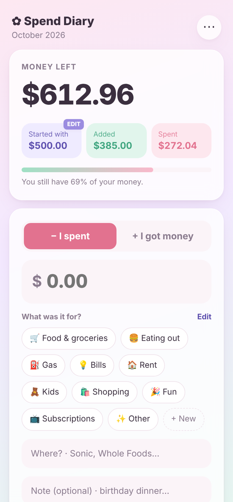
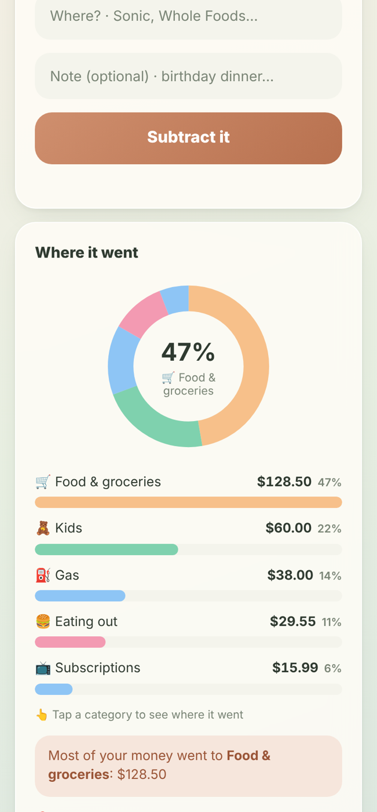
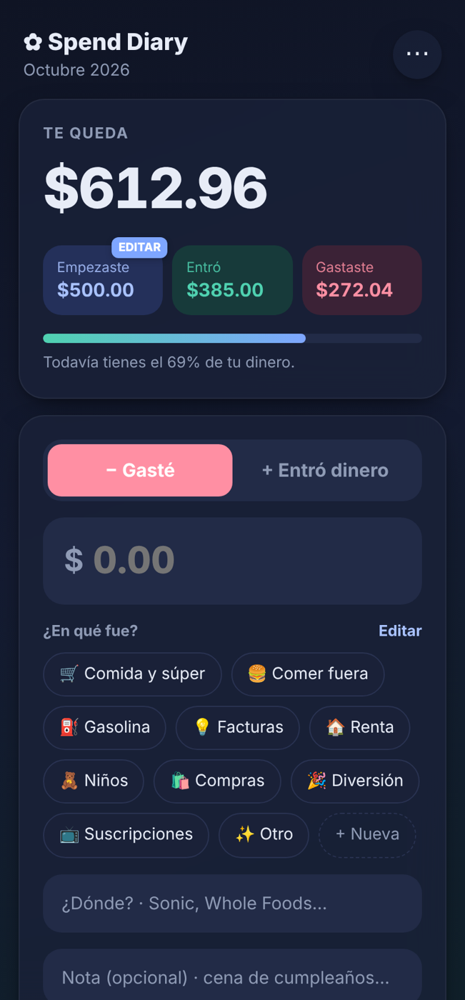
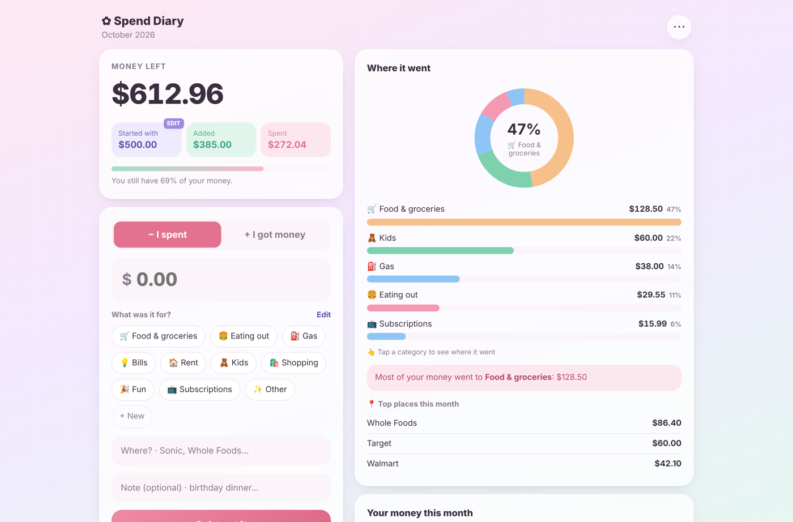

# ✿ Spend Diary

A simple, private money tracker. Log what you spend and what comes in, and see where your money goes.

**No accounts. No servers. No tracking.** Your numbers are saved only on your own device.

<p align="center">
  
  
  
</p>



## Features
- 💸 Log spending and money coming in with one tap per category
- 🏷️ Add, rename and delete your own categories (with emoji + color)
- 📍 **Where?** field that remembers places (Sonic, Whole Foods…) and shows your top places
- 👆 Tap a category to see it broken down by place
- 🍩 **Donut chart:** where most of your money goes
- 📈 **Line chart:** your balance day by day through the month
- 📊 **Bar charts:** spending and income by category
- 🗓️ Start a new month and keep past months for comparison
- 🌸 🌿 🌙 Three themes: Blush, Sage, Midnight
- 🇺🇸 🇲🇽 English and Spanish
- 📱 Works on phone, iPad and computer, and can be installed to the home screen
- 📲 Back up and restore to move your data to another device
- ✈️ Works offline after the first visit
- ✨ Smooth animations: charts draw in, sparkle burst when money comes in, entries slide in and out (turned off automatically for people who prefer reduced motion)

## Tech
Plain **HTML, CSS and JavaScript**, with no frameworks, libraries or build step.

| File | Job |
|---|---|
| `index.html` | Page structure |
| `css/themes.css` | The 3 color themes (CSS variables) |
| `css/styles.css` | Layout, components, responsive design |
| `js/helpers.js` | Small shared tools (formatting money, escaping text) |
| `js/i18n.js` | English + Spanish text |
| `js/storage.js` | Saving/loading with localStorage + data validation |
| `js/charts.js` | Donut, bar and line charts drawn with SVG |
| `js/app.js` | Rendering the screen and handling every button |
| `sw.js` | Service worker for offline use |
| `vercel.json` | Security headers (Content-Security-Policy, etc.) |

The full walkthrough of how the code works and why it's built this way is in **[EXPLAINED.md](EXPLAINED.md)**.

## Live demo
Coming soon on Vercel.

## Run it locally
```bash
npx serve .
```
Then open the address it prints. You can also just open `index.html` in a browser; everything except offline mode works that way.

## Deploy (Vercel)
1. Push this repo to GitHub.
2. On vercel.com: **Add New → Project →** pick the repo.
3. Framework preset: **Other**. Leave the build command empty. Click **Deploy**.

## Privacy & security
- Data lives in the browser's `localStorage` and never leaves the device.
- Everything people type is escaped before it's shown, to prevent XSS.
- Backup files are validated before they're loaded.
- `vercel.json` sets a strict Content-Security-Policy that blocks outside scripts and outgoing network requests.

## Roadmap
- [ ] Accounts with **end-to-end encrypted** sync across devices
- [ ] Native iOS/Android app (React Native + Expo)
- [ ] Monthly budget goals per category
