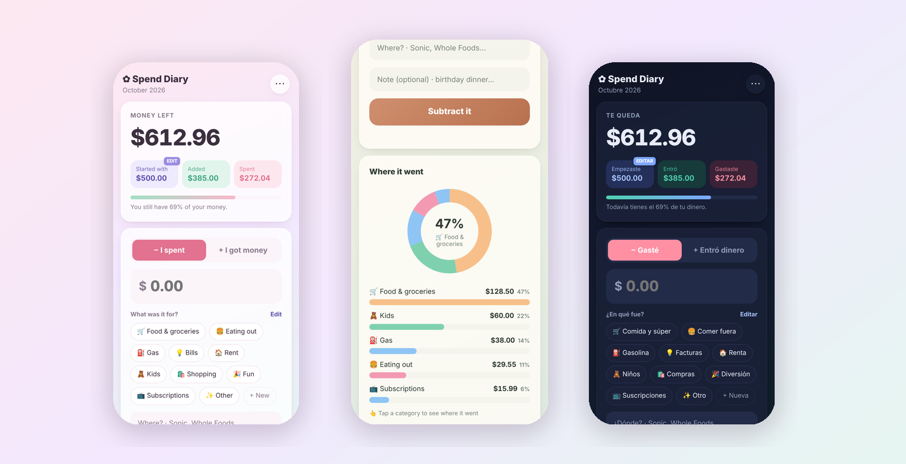

<div align="center">

# ✿ Spend Diary

**See where your money goes. Privately.**

A simple, bilingual money tracker that runs entirely in your browser.<br>
No accounts. No servers. No tracking. Your numbers never leave your device.

[**🚀 Try it live**](https://spend-diary-nine.vercel.app) · [How it works](EXPLAINED.md) · [Report a bug](https://github.com/stackmindlab/spend-diary/issues)




</div>

---

## ✨ Why I built it

I kept ending the month with no money and no idea where it went. Bank apps want your login, and spreadsheets are a chore on a phone.
So I built the tool I wanted: **log a spend in two taps, and see at a glance where it's going.**

## 🎬 Demo

<div align="center">
  
</div>

## 💸 Features

|                               |                                                                                                                                        |
| ----------------------------- | -------------------------------------------------------------------------------------------------------------------------------------- |
| **Log money in seconds**      | Tap a category, type the amount, done. Spending and money in are tracked separately.                                                   |
| **📍 Where did it go?**       | Add the place (Sonic, Whole Foods…). The app remembers your places and suggests them next time.                                        |
| **🍩 See the big picture**    | A donut chart of where most of your money goes, bars by category, and your **top places** this month.                                  |
| **👆 Drill down**             | Tap any category to see it broken down by place.                                                                                       |
| **📈 Your month at a glance** | A line chart of your balance day by day, so you can see _when_ the money disappears.                                                   |
| **🏷️ Your own categories**    | Add, rename or delete categories with your own emoji and color. Deleting asks where to move old entries, so totals stay correct.       |
| **🗓️ Monthly reset**          | Start a new month and keep past months to compare.                                                                                     |
| **🌸🌿🌙 Three themes**       | Blush, Sage and Midnight.                                                                                                              |
| **🇺🇸🇲🇽 English & Español**    | Switch anytime. Picks your phone's language automatically.                                                                             |
| **📱 Works everywhere**       | Phone, iPad and desktop (two-column layout on big screens). Install it to your Home Screen. Works offline.                             |
| **📲 Move devices**           | Back up to a file and restore it on another device.                                                                                    |
| **✨ Smooth animations**      | Charts draw in, a sparkle burst when money comes in, entries slide in and out. Automatically off for people who prefer reduced motion. |

## 🔒 Privacy & security

- **Your data stays on your device.** It's stored in the browser's `localStorage`. There's no backend or database, so there's nothing to breach.
- **XSS-safe rendering.** Everything a user types is escaped before it's displayed.
- **Validated imports.** Backup files are checked field by field before they're trusted.
- **Strict security headers** via `vercel.json`: a Content-Security-Policy that blocks outside scripts and outgoing requests, no framing, and no referrer.

> **Trade-off:** no sync between devices (yet). Each browser keeps its own data, so back up now and then.

## 🛠️ Tech stack

**Plain HTML, CSS and JavaScript**, with no frameworks, no libraries and no build step.

- Charts are **hand-drawn with SVG** (no chart library)
- **CSS variables** power the three themes
- **`Intl` / `toLocaleDateString`** for English and Spanish dates
- **Service worker + web manifest** make it an installable, offline-ready **PWA**
- Deployed on **Vercel**, which auto-deploys on every merge to `main`

## 📁 Project structure

```
spend-diary/
├── index.html            # Page structure
├── css/
│   ├── themes.css        # Blush, Sage, Midnight (CSS variables)
│   └── styles.css        # Layout, components, animations, responsive
├── js/
│   ├── helpers.js        # Shared tools: money format, escapeHTML (XSS)
│   ├── i18n.js           # English + Spanish text
│   ├── storage.js        # localStorage save/load + data validation
│   ├── charts.js         # Donut, bar and line charts (SVG)
│   └── app.js            # Rendering + every button
├── sw.js                 # Offline support
├── manifest.webmanifest  # Home Screen install
├── vercel.json           # Security headers
└── EXPLAINED.md          # Full code walkthrough
```

**Core idea:** every action changes one `state` object → saves it → calls `render()`, which redraws the screen. See **[EXPLAINED.md](EXPLAINED.md)** for the full walkthrough.

## 🚀 Run it locally

```bash
git clone https://github.com/stackmindlab/spend-diary.git
cd spend-diary
npx serve .
```

Or open the folder in VS Code and use **Live Server**.

## 🗺️ Roadmap

- [ ] "Add to Home Screen" hint for iPhone, and an install button on Android
- [ ] Backup reminder
- [ ] Currency picker (Dollar, Peso, Euro…)
- [ ] Pick a date when logging
- [ ] Monthly budget per category
- [ ] Sync across devices with accounts and end-to-end encryption (MERN)

## 🙋‍♀️ About

Built by [stackmindlab](https://github.com/stackmindlab), a full-stack developer focused on privacy-first, AI-assisted development.
